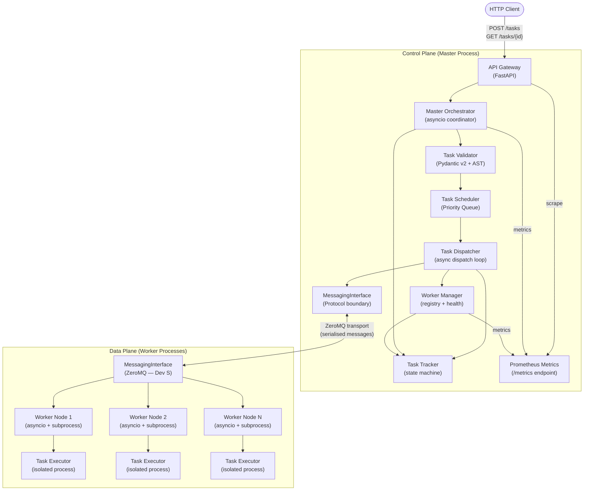

# System Architecture — Ultra-Low Latency Distributed Edge-Compute Orchestrator

---

| Field   | Value                    |
|---------|--------------------------|
| Version | 0.1.0                    |
| Author  | Developer V              |
| Date    | November 2026            |
| Status  | Approved                 |

---

## Table of Contents

1. [Architectural Overview](#1-architectural-overview)
2. [Architectural Principles](#2-architectural-principles)
3. [System Components](#3-system-components)
4. [Architecture Diagram](#4-architecture-diagram)
5. [Control Plane vs Data Plane Separation](#5-control-plane-vs-data-plane-separation)
6. [Technology Decisions](#6-technology-decisions)
7. [ZeroMQ Integration Boundary](#7-zeromq-integration-boundary)
8. [Scalability Considerations](#8-scalability-considerations)
9. [Limitations and Future Work](#9-limitations-and-future-work)

---

## 1. Architectural Overview

The Ultra-Low Latency Distributed Edge-Compute Orchestrator is built on a **single-master, multi-worker topology**. In this model, one authoritative process — the **Master Orchestrator** — holds all scheduling and coordination state, while an arbitrary number of **Worker Nodes** execute compute tasks in isolated subprocesses.

### What "Single-Master Multi-Worker" Means

- **Single master**: There is exactly one process responsible for accepting task submissions, validating payloads, maintaining scheduling queues, tracking task lifecycle state, and routing work to workers. The master owns no long-running CPU work of its own.
- **Multi-worker**: Any number of worker nodes may be registered with the master simultaneously. Each worker is an independent OS process (or remote machine) that accepts dispatched tasks, executes them in a sandboxed subprocess, and returns structured results.

### Why This Topology Was Chosen

| Consideration | Rationale |
|---|---|
| **Operational simplicity** | A single coordination point eliminates split-brain scenarios, leader elections, and distributed consensus overhead that multi-master designs require. |
| **Latency predictability** | The master's event loop never performs CPU-bound work, so scheduling and dispatch latency remains in the sub-millisecond range even under high task throughput. |
| **Clear failure domain** | Exactly one component is authoritative; failure semantics and recovery paths are straightforward to reason about and test. |
| **Horizontal elasticity** | Workers join and leave the cluster at runtime without master restarts, providing near-elastic horizontal scalability. |
| **Phase-1 scope** | For the initial delivery phase the team prioritised correctness, testability, and clean interface boundaries over redundant-master complexity. High-availability master failover is scoped to Phase 2. |

---

## 2. Architectural Principles

The system is designed around seven non-negotiable architectural principles. Every design decision in the codebase should be evaluable against this list.

### 1. Async-First

All I/O — network reads/writes, inter-component signalling, and result collection — must be expressed as `async`/`await` coroutines and scheduled on the Python `asyncio` event loop (accelerated by `uvloop`). Synchronous blocking calls inside the event loop are forbidden because they stall all concurrent tasks waiting to proceed. CPU-bound work is explicitly moved off the event loop into worker subprocesses or thread-pool executors.

### 2. Control/Data Plane Separation

Orchestration logic (scheduling, dispatch, state tracking, API serving) lives exclusively on the **master** (the control plane). Actual task computation lives exclusively inside **worker processes** (the data plane). No task payload is interpreted by control-plane components beyond schema validation. This separation prevents resource contention between orchestration bookkeeping and compute-intensive user workloads.

### 3. Interface-Driven Integration

All cross-component contracts are expressed as **Python `Protocol` classes** (`typing.Protocol`). Components depend on abstract interfaces, not concrete implementations. This enables independent testing (via stubs and fakes), swappable implementations (e.g., the ZeroMQ messaging layer can be replaced with any other transport without touching orchestration code), and clear ownership boundaries between team members.

### 4. Zero Shared Mutable State Between Planes

The control plane and data plane share no in-process mutable objects. All communication between the master and workers passes through the `MessagingInterface` protocol, which serialises and deserialises messages at the boundary. Neither plane can corrupt the other's internal state because neither has a reference to the other's objects.

### 5. Platform Portability

The core orchestration logic must run on any POSIX-compatible system and on Windows without platform-specific code paths. Platform abstraction is achieved through Python's standard library (`asyncio`, `subprocess`, `concurrent.futures`) and cross-platform dependencies. Worker execution uses `multiprocessing`-compatible subprocess spawning. External OS services (systemd, etc.) are optional deployment concerns, not core requirements.

### 6. Modularity

Each system component (see Section 3) is independently importable, independently testable, and independently replaceable. The dependency graph between modules is a DAG with no cycles. No module imports from a module at a higher abstraction layer than itself. The entry-point wires components together via dependency injection rather than global singletons.

### 7. Observability-First

Every significant system event — task submission, validation failure, scheduling, dispatch, execution start/end, result receipt, worker health change — must emit a structured metric or log event. Prometheus counters, gauges, and histograms are defined alongside the components they measure, not retrofitted later. Dashboards and alerts are first-class deliverables, not afterthoughts.

---

## 3. System Components

The system is composed of nine logical components (the tenth, Monitoring, is a cross-cutting concern). Each component has a single, clearly bounded responsibility.

---

### 3.1 API Gateway (FastAPI)

**Location**: `src/api/`  
**Technology**: FastAPI, Uvicorn, Pydantic v2  
**Responsibility**: Provides the external HTTP/REST interface for task submission, task status polling, worker registration (optional REST path), and system health checks.

The API layer is intentionally thin. It deserialises and validates the wire format of incoming requests using Pydantic models, then delegates to the Master Orchestrator via its defined interface. It never touches scheduling logic, worker state, or the messaging layer. All endpoints are `async` functions to avoid blocking the event loop during I/O.

Key endpoints:

| Method | Path | Description |
|--------|------|-------------|
| `POST` | `/tasks` | Submit a new task for execution |
| `GET`  | `/tasks/{task_id}` | Poll the current state of a submitted task |
| `GET`  | `/workers` | List registered workers and their status |
| `GET`  | `/health` | Liveness check for load-balancer probing |
| `GET`  | `/metrics` | Prometheus metrics scrape endpoint |

---

### 3.2 Master Orchestrator

**Location**: `src/orchestrator/`  
**Technology**: Python asyncio  
**Responsibility**: The central coordination hub. Owns the top-level async event loop logic that ties all control-plane components together. Receives validated task requests from the API layer, hands them to the Scheduler, coordinates with the Dispatcher when workers are available, and surfaces results back to callers.

The Orchestrator does not implement scheduling or dispatch logic itself — it delegates to the Scheduler and Dispatcher components and acts as the composition root for the control plane. It is the only component that holds references to all other control-plane components.

---

### 3.3 Task Validator

**Location**: `src/edge_orchestrator/core/task_validator.py`, `src/edge_orchestrator/security/ast_validator.py`  
**Technology**: Pydantic v2, Python `ast` module  
**Responsibility**: Validates incoming task payloads against the canonical `Task` schema and performs static analysis on user-supplied code snippets before they enter the scheduling queue.

Validation is a two-stage process:

1. **Schema validation** — Pydantic v2 parses the raw dict/JSON into a `Task` model, enforcing field types, required fields, and value constraints (e.g., `timeout_seconds > 0`, `max_retries >= 0`, `1 <= priority <= 100`).
2. **AST validation (Static Pre-Filter)** — If the task includes an inline Python code snippet, the `ast.parse()` function is used to verify syntax and inspect for prohibited AST nodes (`import`, `eval`, `exec`, `open`).

> **Critical Security Distinction**: AST validation is strictly a **static pre-filter**, NOT a secure runtime execution sandbox. Restricted builtins and AST rules alone cannot make arbitrary Python execution safe in-process. Hard runtime isolation is executed on worker nodes using dedicated OS child processes, POSIX resource limits (rlimit), and Linux container/cgroup boundaries.

Validation failures raise structured errors that the API layer converts to HTTP 422 responses with actionable detail messages.

---

### 3.4 Task Scheduler

**Location**: `src/scheduler/`  
**Technology**: Python `asyncio.PriorityQueue`  
**Responsibility**: Maintains an ordered queue of validated tasks awaiting dispatch and determines the order in which tasks are offered to the Dispatcher.

The scheduler uses a priority-queue internally. Each enqueued task carries a numeric priority value derived from the `TaskDefinition`. Lower numeric priority values are dequeued first (min-heap semantics). Within equal priority, tasks are ordered by submission timestamp (FIFO) using a stable tie-breaking key, ensuring deterministic ordering.

The scheduler exposes two async operations:
- `enqueue(task)` — adds a validated task to the queue.
- `dequeue()` — awaits the next highest-priority task when a free worker is available.

The scheduler does not know about workers; it only knows about task priority.

---

### 3.5 Task Dispatcher

**Location**: `src/dispatcher/`  
**Technology**: Python asyncio  
**Responsibility**: Bridges the control plane's scheduling queue and the worker pool. When both a pending task and an idle worker are available, the Dispatcher claims the worker, marks the task as `DISPATCHED`, and hands the task to the `MessagingInterface` for transmission to the worker.

The Dispatcher runs a continuous async dispatch loop:

```
while running:
    task = await scheduler.dequeue()
    worker = await worker_manager.acquire_idle_worker()
    await messaging.send_task(worker.id, task)
    await tracker.set_state(task.id, TaskState.DISPATCHED)
```

The Dispatcher never performs I/O itself — it delegates to the `MessagingInterface` protocol implementation, keeping the dispatch logic transport-agnostic.

---

### 3.6 Task Tracker & TaskStore

**Location**: `src/edge_orchestrator/tracking/task_tracker.py`, `src/edge_orchestrator/tracking/task_store.py`  
**Technology**: Python asyncio, concurrent state machine, pluggable `TaskStore` protocol  
**Responsibility**: Maintains the authoritative lifecycle state of every task the system coordinates. Enforces a strict **9-state task lifecycle**:

```
PENDING → VALIDATED → QUEUED → DISPATCHED → RUNNING → COMPLETED
                                              │       ↘ FAILED (retryable)
                                              │       ↘ TIMED_OUT (retryable)
                                              └───────↘ CANCELLED (terminal)
```

- **9 States**: `PENDING`, `VALIDATED`, `QUEUED`, `DISPATCHED`, `RUNNING`, `COMPLETED`, `FAILED`, `TIMED_OUT`, `CANCELLED`.
- **TaskStore Abstraction**: Persistence is decoupled via the `TaskStore` interface protocol.
- **In-Memory Prototype (`InMemoryTaskStore`)**:
  - Protected by `asyncio.Lock` for coroutine safety.
  - Capped at 10,000 records.
  - **Zero Silent Eviction of Active Work**: Active tasks (`PENDING`, `VALIDATED`, `QUEUED`, `DISPATCHED`, `RUNNING`) are NEVER evicted. Only terminal tasks (`COMPLETED`, `FAILED`, `TIMED_OUT`, `CANCELLED`) are evicted under capacity pressure.
  - If all 10,000 slots are active, `TaskStoreCapacityError` is raised.
  - *Volatility Notice*: Tasks are stored in-process; all task records are lost when the master restarts.
- **Transition Enforcement**: Illegal transitions raise `InvalidTransitionError`. Supports retries from `FAILED` / `TIMED_OUT` to `QUEUED`.

---

### 3.7 Worker Manager

**Location**: `src/edge_orchestrator/worker/worker_manager.py`  
**Technology**: Python asyncio, concurrent worker registry  
**Responsibility**: Maintains the registry of all workers that have registered with the master. Tracks each worker's status (`IDLE`, `BUSY`, `OFFLINE`, `DRAINING`) and health (last heartbeat timestamp).

Key responsibilities:
- **Registration**: Process worker registration requests from the messaging layer and add workers to the active registry.
- **Health monitoring & timeout decisions**: Run a background async health-check coroutine. Workers that miss heartbeats beyond the configured threshold are marked `OFFLINE` and removed from the active pool.
- **Decoupled architecture**: Timeout decisions and worker health logic belong exclusively to Developer V's `WorkerManager`, NOT to the transport layer.
- **Availability queries**: Provide `select_worker()` primitives used by the Dispatcher.

---

### 3.8 Worker Node + Task Executor

**Location**: `src/edge_orchestrator/worker/worker_node.py`, `executor.py`, `security/sandbox.py`  
**Technology**: Python asyncio (worker daemon), process sandboxing (dedicated ephemeral child processes)  
**Responsibility**: Receives dispatched tasks from the master, acknowledges receipt immediately (task stays `DISPATCHED`), launches execution in a dedicated child process, reports `TaskStarted` (moves task to `RUNNING`), applies POSIX rlimit/cgroup sandbox boundaries, and returns structured `TaskResult` packets.

Task execution is **strictly isolated** from the worker's own event loop:
- **Dedicated Child Processes**: Untrusted code payloads MUST execute in dedicated child processes (`subprocess` / `asyncio.create_subprocess_exec`).
- **ProcessPoolExecutor Warning**: `ProcessPoolExecutor` reuses pooled processes and therefore **IS NOT A SECURITY SANDBOX**. It is strictly restricted to trusted internal callables.
- The worker daemon process runs an asyncio event loop managing transport sockets, task acks, and heartbeats.

---

### 3.9 Messaging Interface (ZeroMQ Boundary — Developer S)

**Location**: `src/edge_orchestrator/messaging/interface.py` (Protocol contract)  
**Concrete implementation**: Owned and implemented independently by Developer S  
**Technology**: Python `typing.Protocol`, ZeroMQ (`pyzmq`) under the interface  
**Responsibility**: Defines the transport-agnostic integration boundary between the master control plane and distributed edge workers.

The `MessagingInterface` protocol defines:

```python
class MessagingInterface(Protocol):
    # Connection Lifecycle
    async def start(self) -> None: ...
    async def stop(self) -> None: ...
    async def connect_worker(self, worker_id: str, address: str) -> None: ...
    async def disconnect_worker(self, worker_id: str) -> None: ...

    # Worker Registration Handshake
    def listen_for_registrations(self) -> AsyncIterator[WorkerInfo]: ...
    async def send_registration_ack(self, worker_id: str, accepted: bool, reason: str = "") -> None: ...

    # Task Operations & Two-Stage Confirmation
    async def send_task(self, worker_id: str, task: Task) -> None: ...
    async def await_task_ack(self, worker_id: str, task_id: str, timeout_seconds: float = 5.0) -> Optional[TaskAcknowledgement]: ...
    async def await_task_started(self, worker_id: str, task_id: str, timeout_seconds: float = 10.0) -> Optional[TaskStarted]: ...
    async def send_cancellation(self, worker_id: str, task_id: str) -> None: ...

    # Result Reception & Heartbeats
    async def receive_result(self, timeout_seconds: float = 30.0) -> TaskResult: ...
    def listen_for_heartbeats(self) -> AsyncIterator[HeartbeatMessage]: ...
```

#### Acknowledgement & Lifecycle Semantics
- **Worker Registration Ack** (`send_registration_ack`): Master -> Worker. Confirms whether a worker is admitted to the cluster.
- **Task Receipt Ack** (`await_task_ack`): Worker -> Master. Confirms worker received and enqueued the task. **Task remains in DISPATCHED**.
- **Task Started Event** (`await_task_started`): Worker -> Master. Confirms worker spawned child process. **Triggers transition DISPATCHED -> RUNNING**.

#### Separation of Responsibilities
- Developer S's transport handles wire sockets, frame serialization, and network transmission.
- Developer V's orchestrator handles task timeout detection, failure evaluation, retries, worker health status, and state transitions. Transport never makes business or state decisions.

Developer V owns the protocol definition and a **stub implementation** used in tests. Developer S owns the ZeroMQ concrete implementation. This boundary ensures Developer V never imports `zmq` directly and can develop and test the entire control plane in isolation.

---

### 3.10 Monitoring (Prometheus)

**Location**: Cross-cutting, `src/monitoring/`  
**Technology**: `prometheus_client` Python library  
**Responsibility**: Exposes an HTTP `/metrics` endpoint that Prometheus scrapes. Metrics are defined as module-level singletons (Counter, Gauge, Histogram) adjacent to the components they measure.

Key metric families:

| Metric | Type | Description |
|--------|------|-------------|
| `orchestrator_tasks_submitted_total` | Counter | Tasks received by the API |
| `orchestrator_tasks_completed_total` | Counter | Tasks that reached COMPLETED state |
| `orchestrator_tasks_failed_total` | Counter | Tasks that reached FAILED state |
| `orchestrator_task_duration_seconds` | Histogram | End-to-end task latency (submit → complete) |
| `orchestrator_queue_depth` | Gauge | Current number of tasks awaiting dispatch |
| `orchestrator_workers_registered` | Gauge | Number of registered workers |
| `orchestrator_workers_idle` | Gauge | Number of currently idle workers |

---

## 4. Architecture Diagram



---

## 5. Control Plane vs Data Plane Separation

### What Lives Where

| Concern | Plane | Component |
|---------|-------|-----------|
| Task submission + validation | Control | API Gateway, Task Validator |
| Scheduling order | Control | Task Scheduler |
| Worker selection | Control | Task Dispatcher, Worker Manager |
| Task state bookkeeping | Control | Task Tracker |
| Transport serialisation | Boundary | MessagingInterface (Protocol) |
| ZeroMQ socket management | Boundary → Data | ZeroMQ impl (Developer S) |
| Task execution (user code) | Data | Task Executor (subprocess) |
| Worker event loop | Data | Worker Node |
| Heartbeat emission | Data | Worker Node |

### Why CPU Work Must Not Enter the Event Loop

Python's `asyncio` event loop is **single-threaded**. At any point in time, exactly one coroutine is running. The event loop achieves concurrency by rapidly switching between coroutines at `await` points — but only while each coroutine is waiting on I/O, not while it is computing.

If a CPU-bound function (e.g., running user-provided compute code) is called directly inside a coroutine without offloading it, it **blocks the entire event loop** for its entire duration. During that time:
- No new HTTP requests are accepted.
- No heartbeats are sent to workers.
- No results from other workers are received.
- No scheduling decisions are made.

This is antithetical to the system's latency guarantees. Therefore:
- The control plane **never** runs user code, transforms large data blobs, or performs any significant computation.
- The data plane always executes user code in a **separate OS process** (`ProcessPoolExecutor` or `subprocess`), leaving the worker's own event loop free to handle heartbeats and messaging.

The `asyncio.get_event_loop().run_in_executor()` or `loop.run_in_executor(None, ...)` pattern is used for any unavoidably synchronous I/O that cannot be replaced with an async library.

---

## 6. Technology Decisions

| Technology | Version | Decision Rationale |
|---|---|---|
| **Python** | 3.11 | Provides `asyncio` task groups (`TaskGroup`, PEP 654), better error messages, and `tomllib` in stdlib. 3.11 delivers ~25% faster CPython bytecode evaluation vs 3.10, meaningful in tight scheduling loops. |
| **asyncio** | stdlib | Native async I/O framework; avoids the complexity of Twisted or Trio while providing sufficient primitives (queues, locks, events, task groups) for this system's concurrency model. |
| **uvloop** | ≥ 0.19 | Drop-in replacement for the default asyncio event loop implemented in Cython over libuv. Benchmarks consistently show 2–4× throughput improvement for I/O-heavy workloads. Used in production mode; standard asyncio loop is used in tests for debuggability. |
| **FastAPI** | ≥ 0.110 | Async-native HTTP framework with automatic OpenAPI schema generation from Pydantic models. Integrates cleanly with Uvicorn (ASGI server on uvloop). Provides dependency injection for wiring control-plane components into route handlers. |
| **Pydantic v2** | ≥ 2.6 | Rust-backed validation engine (10–50× faster than v1 for large payloads). Provides the canonical `TaskDefinition`, `TaskResult`, and `WorkerRegistration` schemas. Used for both API-layer deserialization and inter-component data contracts. |
| **Prometheus** (`prometheus_client`) | ≥ 0.20 | De-facto standard for metrics in distributed Python services. Pull-based model (Prometheus scrapes `/metrics`) decouples metric emission from metric storage. Integrates trivially with Grafana for dashboards and Alertmanager for alerting. |

---

## 7. ZeroMQ Integration Boundary

### The MessagingInterface Protocol Approach

The `MessagingInterface` is defined as a `typing.Protocol` in `src/messaging/interface.py`. This means any class that implements the required methods is automatically a valid `MessagingInterface` without inheriting from it. Protocol structural typing is used (not nominal subclassing) so that Developer S's ZeroMQ implementation does not need to import from Developer V's module.

The Protocol approach provides three concrete benefits:

1. **Compile-time (mypy) verification** that all implementations satisfy the interface contract.
2. **Test isolation** — Developer V can test the entire control plane with a lightweight `StubMessaging` class that records calls without touching sockets.
3. **Future transport flexibility** — NATS, MQTT, or gRPC could replace ZeroMQ by providing a conformant implementation of the same protocol.

### Why Developer V Never Imports ZeroMQ

ZeroMQ (`pyzmq`) is not a dependency of the control-plane source tree. Only `src/messaging/interface.py` (the Protocol) and the stub are in Developer V's scope. The ZeroMQ concrete implementation lives in a separate module owned by Developer S.

This boundary means:
- Developer V's unit tests run without `pyzmq` installed.
- CI pipelines for the control plane do not require ZeroMQ native libraries.
- The control plane can be developed and tested entirely on machines where ZeroMQ is not installed.

### What the Stub Is For

`src/messaging/stub.py` provides `StubMessaging`, a fully in-memory implementation of `MessagingInterface`. It uses `asyncio.Queue` objects to simulate task send/receive. It is used exclusively in:

- Unit tests for the Dispatcher, Orchestrator, and Worker Manager.
- Integration tests that validate the full control-plane flow without network I/O.
- Local development where spinning up real ZeroMQ sockets adds friction.

The stub is **never** used in production or staging environments.

---

## 8. Scalability Considerations

### Horizontal Worker Scaling

Workers are independent OS processes (or machines) that connect to the master's ZeroMQ socket. Adding capacity is a matter of launching additional worker processes pointing at the master's endpoint. No master restart is required, no configuration file change is needed — the worker registers itself over the messaging layer, and the Worker Manager adds it to the pool immediately.

The system is designed such that the master's scheduling throughput scales with the number of idle workers: more workers means more concurrent dispatches, and the dispatcher's async loop issues dispatches as fast as workers can accept them.

### Adding Workers at Runtime

The Worker Manager's registration handler is an always-running async coroutine that calls `await messaging.receive_registration()` in a loop. When a new worker connects and sends its registration message, the master adds it to the registry within one event-loop cycle. The new worker becomes eligible for dispatch on the very next dequeue iteration.

### Master as Single Point of Coordination

The master is the sole source of truth for task state and worker availability. This is intentional for Phase 1: it eliminates distributed consensus complexity. The practical scalability ceiling of the master is determined by:

- Event-loop throughput (tasks/second the asyncio loop can schedule).
- In-memory state size (task tracker dictionary).
- Messaging layer throughput (ZeroMQ's pub/sub or push/pull throughput, which is very high).

For the anticipated Phase 1 workloads (hundreds to low thousands of tasks/second), a single Python asyncio master on modern hardware with uvloop is well within capacity. Benchmarking and profiling gates are defined as a Phase 2 milestone.

---

## 9. Limitations and Future Work

### Current Limitations (Phase 1)

| Limitation | Impact | Notes |
|---|---|---|
| **Single master, no HA** | Master failure stops all orchestration | Workers buffer results until master reconnects (ZeroMQ durability), but no automatic failover |
| **In-memory task state** | State lost on master restart | No persistent task history across restarts |
| **First-idle worker selection** | No load balancing or capability matching | May result in uneven worker utilisation |
| **No authentication/authorisation** | Any client can submit tasks | Assumed to run in a trusted internal network |
| **No task result persistence** | Results must be collected before master restart | No durable result store |
| **Static worker capacity** | Workers must be manually launched | No autoscaling integration |

### Planned Phase 2 Items

1. **Master HA / Hot-Standby**: A passive secondary master subscribes to all state events from the primary. On primary failure, the secondary promotes itself without data loss.
2. **Persistent Task Store**: Replace the in-memory tracker with a lightweight embedded store (SQLite via `aiosqlite`, or Redis via `aioredis`) for durability across restarts.
3. **Capability-Aware Scheduling**: Worker registration carries a `capabilities` dict. The dispatcher matches task `required_capabilities` against the worker registry before selection.
4. **Autoscaling Integration**: A scaling controller watches `orchestrator_queue_depth` and `orchestrator_workers_idle` metrics and calls a worker-launch API (Kubernetes, Docker, or bare-metal) to adjust pool size.
5. **mTLS on Messaging Layer**: Mutual TLS authentication on ZeroMQ sockets to authenticate workers and encrypt the data plane.
6. **Result Streaming**: Allow clients to subscribe to a task result stream rather than polling the status endpoint.
7. **Master Performance Benchmarking**: Establish a reproducible benchmark harness; profile the event loop under sustained load; identify and eliminate any O(N) operations in scheduling hot paths.
