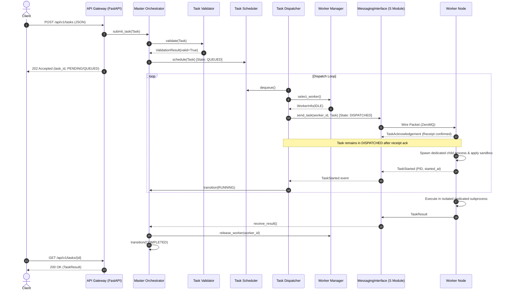
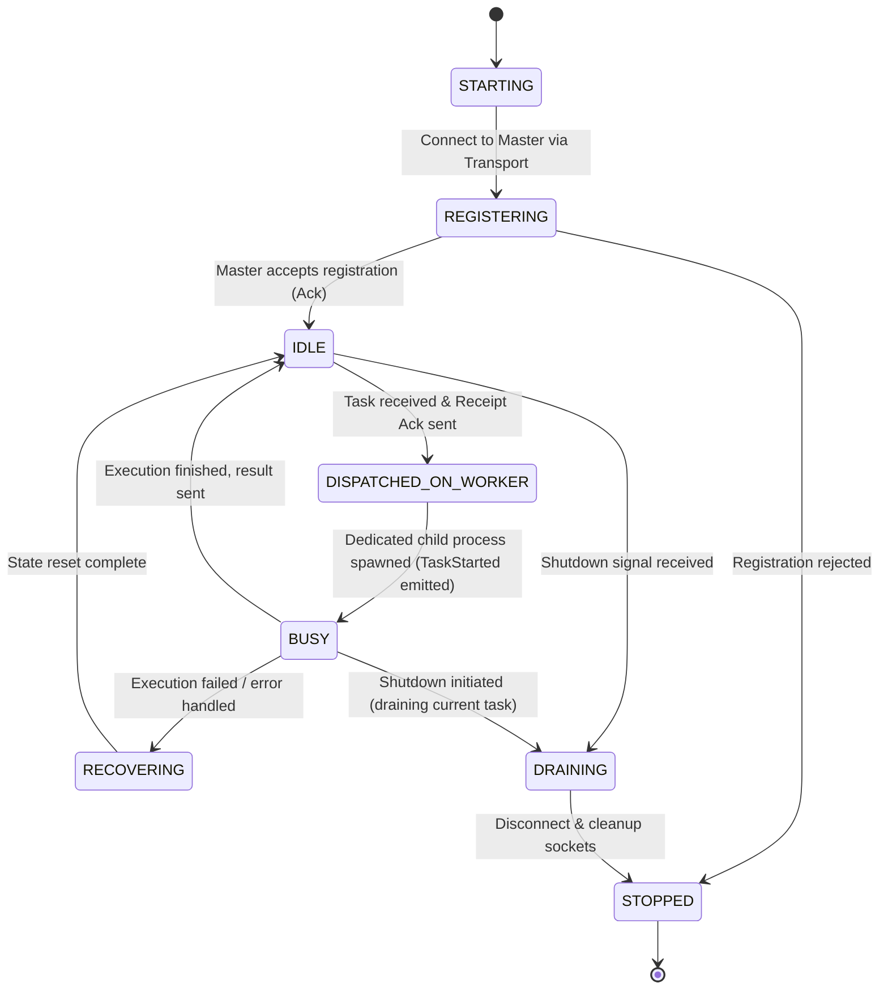

# Master-Worker Design — Edge Orchestrator

**Version:** 0.1.0  
**Author:** Developer V  
**Date:** November 2026  
**Status:** Approved  

---

## Table of Contents

1. [Design Philosophy](#1-design-philosophy)
2. [Master Node Responsibilities](#2-master-node-responsibilities)
3. [Master Component Interaction Diagram](#3-master-component-interaction-diagram)
4. [Worker Node Responsibilities](#4-worker-node-responsibilities)
5. [Worker Node Lifecycle Diagram](#5-worker-node-lifecycle-diagram)
6. [Concurrent Worker Execution](#6-concurrent-worker-execution)
7. [The 9-State Task Lifecycle](#7-the-9-state-task-lifecycle)
8. [Retry, Timeout, and Cancellation Policies](#8-retry-timeout-and-cancellation-policies)
9. [Worker Selection Strategies](#9-worker-selection-strategies)
10. [Error Handling Boundaries and Team Separation](#10-error-handling-boundaries-and-team-separation)

---

## 1. Design Philosophy

The Ultra-Low Latency Distributed Edge-Compute Orchestrator employs a **single-master, multi-worker architecture** designed around strict separation between the **control plane** (orchestration, validation, scheduling, tracking) and the **data plane** (computational execution).

### Why Master-Worker?
Edge environments are characterized by heterogeneous, physically distributed, and occasionally unreliable compute nodes. A centralized master provides:
- **Authoritative task ordering and state tracking**: Prevents duplicate execution and eliminates distributed consensus overhead (e.g. Raft/Paxos) on the hot path.
- **Ultra-low latency scheduling**: By ensuring the master process never performs computational work, its `asyncio` event loop runs unimpeded, achieving sub-millisecond scheduling decisions.
- **Independent worker scaling**: Workers join or leave dynamically without restarting the cluster or disturbing active tasks.

### Cooperative Concurrency vs Process Parallelism
- **Master Node**: Uses cooperative multitasking via Python's `asyncio` event loop (accelerated by `uvloop` on Linux). Because all master operations are I/O-bound (network requests, queue management, status updates), a single thread multiplexes thousands of concurrent connections with minimal overhead.
- **Worker Nodes**: Execute tasks in isolated OS subprocesses. Python's Global Interpreter Lock (GIL) and single-threaded CPU execution mean compute-heavy tasks MUST NOT run in the event loop. Worker subprocesses provide true multi-core hardware parallelism without starving communication channels.

---

## 2. Master Node Responsibilities

The master node is the brain of the cluster, owned and implemented by Developer V. It is responsible for eight core functions:

1. **Receive Computational Tasks**: Ingests task definitions via the asynchronous FastAPI REST gateway (`POST /api/v1/tasks`). Immediately assigns a UUID4 and records initial state.
2. **Validate Incoming Tasks**: Executes a two-stage validation pipeline:
   - *Schema validation*: Pydantic v2 enforces types, bounds, and required metadata.
   - *Static AST validation*: Inspects Python code payloads (`ast.parse`) to detect and reject disallowed operations (`import`, `open`, `eval`, `exec`) before scheduling.
3. **Schedule Tasks**: Places validated tasks into an async priority queue (`AsyncTaskQueue`). Priority values determine dequeue order, with FIFO ordering for identical priority levels.
4. **Select Appropriate Workers**: Interrogates `WorkerManager` to identify healthy, idle worker nodes based on capability tags and availability.
5. **Dispatch Tasks**: Routes tasks to chosen workers via the `MessagingInterface` contract. Initiates the task timeout watchdog.
6. **Track Task Status**: Maintains the authoritative 9-state machine via `TaskTracker`. Records state transitions and timestamps in an audit log protected by `asyncio.Lock`.
7. **Collect Results**: Consumes result packets returned by workers via `MessagingInterface.receive_result()`. Stores outputs and completes the lifecycle.
8. **Manage Worker Availability**: Listens to periodic worker heartbeats (`WorkerManager`). Detects worker unresponsiveness and marks dead workers `OFFLINE`.

---

## 3. Master Component Interaction Diagram

---

## 4. Worker Node Responsibilities

Worker nodes run at the distributed edge and execute workloads assigned by the master:

1. **Register with the Orchestrator**: On startup, connect to the master's endpoint via ZeroMQ and transmit a `WorkerInfo` registration frame (ID, network address, capability tags, concurrency limit).
2. **Receive Assigned Tasks**: Listen on the task reception channel for incoming task definitions dispatched by the master.
3. **Acknowledge Task Receipt**: Immediately return a `TaskAcknowledgement` frame back to the master confirming that the task has been received, decoded, and queued for execution. *The task remains in DISPATCHED on the master.*
4. **Report Execution Started**: When execution is about to begin, emit a `TaskStarted` notification back to the master. *This triggers the master's transition from DISPATCHED to RUNNING.*
5. **Execute Approved Tasks in Dedicated Subprocesses**:
   - Untrusted/submitted code payloads MUST execute in **ephemeral, dedicated child processes** (`subprocess.Popen` / `asyncio.create_subprocess_exec`).
   - `ProcessPoolExecutor` is **NOT a security sandbox**; it reuses pooled processes across tasks, causing state, memory, and thread bleed. `ProcessPoolExecutor` is restricted exclusively to trusted, controlled internal workloads.
   - Enforce process resource limits (`SandboxPolicy`: CPU, memory, open file descriptors).
6. **Return Results**: Capture stdout, execution time, and return payloads; transmit a structured `TaskResult` back to the master.
7. **Report Status & Heartbeats**: Emit periodic `HeartbeatMessage` packets (default every 5 seconds) to demonstrate liveness and current load status.
8. **Handle Execution Errors**: Catch unhandled exceptions, syntax errors, or timeouts within user code; format and return an error `TaskResult` rather than crashing the worker node daemon.

---

## 5. Worker Node Lifecycle Diagram

---

## 6. Concurrent Worker Execution

### How Multiple Workers Operate Concurrently
In our distributed topology, $N$ independent worker nodes connect to the master over network transports:

1. **Non-Blocking Coordination**: The master uses `asyncio` to manage sockets. When the master dispatches tasks to 50 workers, it does not block waiting for Worker 1 before dispatching to Worker 2. The dispatch loop issues `send_task` coroutines asynchronously.
2. **Interleaved Liveness & Results**: Heartbeats, task acknowledgements, task-started events, and results arrive concurrently. The master multiplexes incoming socket frames using the event loop's underlying epoll/kqueue selector (via `uvloop`).
3. **Dedicated Process Isolation on Edge Nodes**:
   - Each worker node runs its compute payload in an **ephemeral child subprocess**.
   - `ProcessPoolExecutor` reuses processes and therefore **CANNOT be used as a security sandbox**. It is strictly reserved for trusted internal callables.
   - Compute jobs pegging 100% of a CPU core run in child processes, leaving the worker node's parent process free to emit heartbeats and exchange ZeroMQ frames.

---

## 7. The 9-State Task Lifecycle

The system enforces a strict 9-state lifecycle model:

| State | Transition Source | Transition Target | Responsible Component | Description |
|---|---|---|---|---|
| **PENDING** | *(Creation)* | VALIDATED, FAILED | API Gateway / Tracker | Task received and registered; awaiting validation. |
| **VALIDATED** | PENDING | QUEUED, FAILED | TaskValidator | Passed schema check and static AST code analysis. |
| **QUEUED** | VALIDATED, FAILED*, TIMED_OUT* | DISPATCHED, CANCELLED | TaskScheduler | Enqueued in `AsyncTaskQueue` awaiting worker availability. |
| **DISPATCHED** | QUEUED | RUNNING, TIMED_OUT, FAILED, CANCELLED | TaskDispatcher | Sent to worker; receipt acknowledged; awaiting explicit execution start. |
| **RUNNING** | DISPATCHED | COMPLETED, FAILED, TIMED_OUT, CANCELLED | TaskDispatcher / Tracker | Worker emitted `TaskStarted`; child process execution actively running. |
| **COMPLETED** | RUNNING | *(Terminal)* | Master Orchestrator | Worker returned successful `TaskResult`. |
| **FAILED** | PENDING, VALIDATED, QUEUED, DISPATCHED, RUNNING | QUEUED (retry) or Terminal | Tracker / Orchestrator | Execution error, validation failure, or unhandled crash. |
| **TIMED_OUT** | DISPATCHED, RUNNING | QUEUED (retry) or Terminal | Watchdog / Orchestrator | Deadline exceeded before receipt ack, start event, or result. |
| **CANCELLED** | QUEUED, DISPATCHED, RUNNING | *(Terminal)* | API Gateway / Tracker | User or admin explicitly requested cancellation. |

*\*Note: `FAILED` and `TIMED_OUT` can transition back to `QUEUED` if `retry_count < max_retries`.*

---

## 8. Task Storage Architecture (TaskStore)

The master node stores task state through an explicit `TaskStore` interface:
- **Prototype Implementation**: `InMemoryTaskStore` backed by a Python dictionary and protected by `asyncio.Lock`.
- **Capacity Limits (10,000 Records)**:
  - Active tasks (`PENDING`, `VALIDATED`, `QUEUED`, `DISPATCHED`, `RUNNING`) are **NEVER evicted**.
  - Eviction applies **only to terminal tasks** (`COMPLETED`, `FAILED`, `TIMED_OUT`, `CANCELLED`) in FIFO order.
  - If capacity is reached and all 10,000 tasks are active, `TaskStoreCapacityError` is raised rather than silently dropping tasks.
- **Persistence Roadmap**: `InMemoryTaskStore` is volatile; state is lost on master restart. In Phase 2, `SQLiteTaskStore` or `RedisTaskStore` can be slotted in by implementing the `TaskStore` protocol.

---

## 8. Retry, Timeout, and Cancellation Policies

### Timeout Policy
Every task specifies a `timeout_seconds` value (default 30s). When dispatched:
- An `asyncio` timeout watchdog coroutine is scheduled on the master: `asyncio.wait_for(..., timeout=timeout_seconds)`.
- If the worker does not acknowledge receipt within 5 seconds, the dispatch fails.
- If the worker does not return a `TaskResult` within the deadline, the watchdog fires.
- The master marks the task `TIMED_OUT` and calls `disconnect_worker(worker_id)` if the worker became unresponsive.

### Retry Policy
When a task enters `FAILED` or `TIMED_OUT`:
1. The orchestrator checks if `task.retry_count < task.max_retries`.
2. If true:
   - Increment `task.retry_count`.
   - Transition task from `FAILED` / `TIMED_OUT` back to `QUEUED`.
   - Re-insert into `AsyncTaskQueue` for dispatch to a different worker.
3. If retries are exhausted:
   - The task remains in its terminal `FAILED` or `TIMED_OUT` state.
   - Emits failure metrics to Prometheus.

### Cancellation Flow
1. Client issues `DELETE /api/v1/tasks/{task_id}`.
2. If `QUEUED`: The task is removed from `AsyncTaskQueue` directly and marked `CANCELLED`.
3. If `RUNNING`: The master calls `MessagingInterface.send_cancellation(worker_id, task_id)`. The worker terminates the child execution process and the master transitions the task to `CANCELLED`.
4. `CANCELLED` tasks are never retried.

---

## 9. Worker Selection Strategies

### Phase 1 Strategy: First-Available Idle Worker
- Scans `WorkerManager` registry for workers with `status == WorkerStatus.IDLE`.
- Returns the first idle worker whose capabilities match the task metadata.
- Simple, deterministic, and sub-millisecond overhead.

### Phase 2 Strategy: Load-Aware & Capability-Matched
- **Capability Filtering**: Matches task tags (e.g. `gpu`, `python3.11`, `high-mem`) against worker capability manifests.
- **Least-Loaded Selection**: Considers running tasks and CPU load score reported in worker heartbeats.
- **Locality-Aware Routing**: Prioritizes workers with lower measured network round-trip time.

---

## 10. Error Handling Boundaries and Team Separation

| Responsibility Domain | Developer V (Architecture & Core) | Developer S (Networking & ZeroMQ) |
|---|---|---|
| **Socket Management** | Strictly forbidden from importing `zmq` | Owns socket types, binding, polling, ZeroMQ context |
| **Wire Protocol** | Defines Pydantic data schemas & `MessagingInterface` | Implements wire serialisation/deserialisation over ZeroMQ |
| **Worker Liveness Decisions** | Evaluates heartbeat timestamps, decides when worker is dead | Delivers raw heartbeat packets through async iterator |
| **Timeout Evaluation** | Owns task watchdogs, timeout state changes, and retries | Flushes or closes worker socket channel upon request |
| **Execution Sandboxing** | AST validation (master) & `SandboxPolicy` abstraction | Ensures network transport does not interfere with child process |
