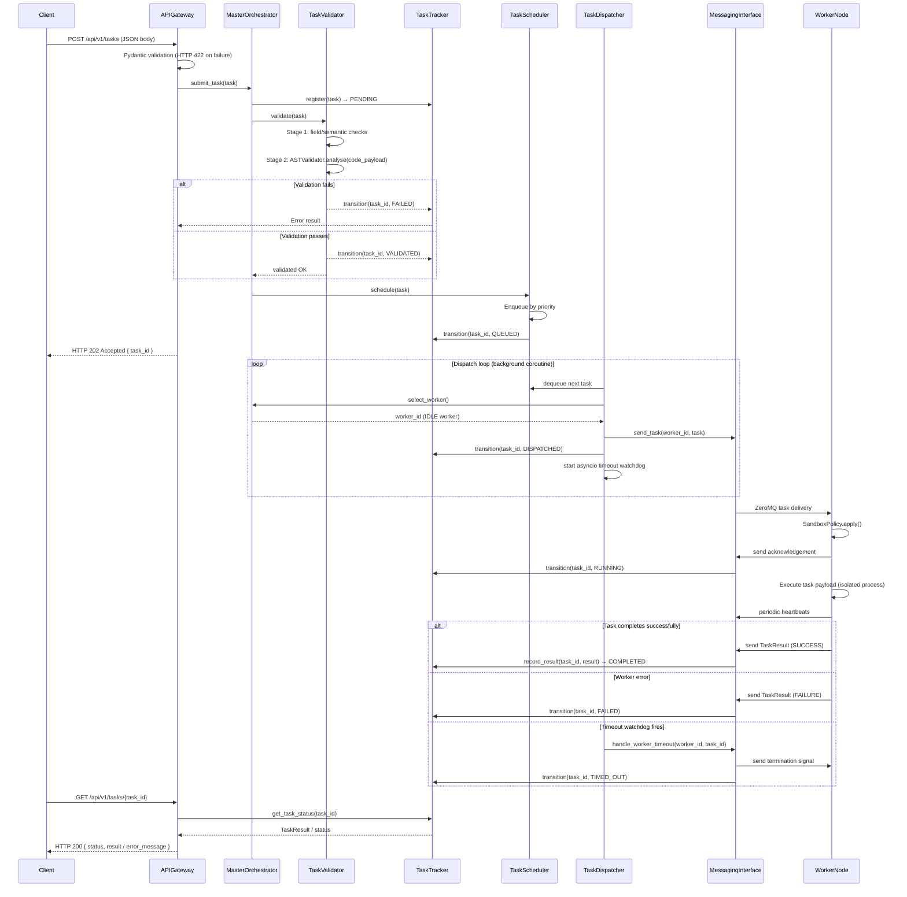

# System Workflow — Task Submission to Result Delivery

**Version:** 0.1.0  
**Author:** Developer V  
**Date:** November 2026  

---

## Table of Contents

1. [Overview](#1-overview)
2. [Phase 1 — Task Submission (Client → API Gateway)](#2-phase-1--task-submission-client--api-gateway)
3. [Phase 2 — Validation (PENDING → VALIDATED)](#3-phase-2--validation-pending--validated)
4. [Phase 3 — Scheduling (VALIDATED → QUEUED)](#4-phase-3--scheduling-validated--queued)
5. [Phase 4 — Dispatching (QUEUED → DISPATCHED)](#5-phase-4--dispatching-queued--dispatched)
6. [Phase 5 — Execution (DISPATCHED → RUNNING)](#6-phase-5--execution-dispatched--running)
7. [Phase 6 — Result Collection (RUNNING → COMPLETED / FAILED / TIMED_OUT)](#7-phase-6--result-collection-running--completed--failed--timed_out)
8. [Retry Logic](#8-retry-logic)
9. [Cancellation Flow](#9-cancellation-flow)
10. [Result Retrieval](#10-result-retrieval)
11. [Full Sequence Diagram](#11-full-sequence-diagram)
12. [Concurrency Model](#12-concurrency-model)

---

## 1. Overview

This document describes the end-to-end lifecycle of a task as it moves through the Ultra-Low Latency Distributed Edge-Compute Orchestrator — from the moment a client submits a task via the REST API to the moment the final result or error status is returned.

The system follows a **single-master, multi-worker architecture**. The master node runs the FastAPI API gateway, the asyncio-based orchestrator, the scheduler, the dispatcher, and the task tracker. Worker nodes receive tasks over the ZeroMQ transport layer, execute them in isolated process contexts, and return results to the master.

The full task lifecycle passes through an authoritative **9-state lifecycle**:

```
PENDING → VALIDATED → QUEUED → DISPATCHED → RUNNING → COMPLETED
                                              │       ↘ FAILED (retryable)
                                              │       ↘ TIMED_OUT (retryable)
                                              └───────↘ CANCELLED (terminal)
```

Each state transition is enforced by `TaskTracker`, which rejects invalid transitions and maintains an append-only audit trail for every task.

---

## 2. Phase 1 — Task Submission (Client → API Gateway)

**State transition:** _(none)_ → **PENDING**

### Steps

1. **Client request**  
   The client sends an HTTP `POST /api/v1/tasks` with a JSON body conforming to the `Task` schema:

   ```json
   {
     "name": "matrix-multiply-job",
     "priority": 2,
     "timeout_seconds": 30,
     "max_retries": 2,
     "code_payload": "result = sum(range(1_000_000))"
   }
   ```

2. **FastAPI deserialisation and schema validation**  
   FastAPI automatically deserialises the JSON body into the `Task` Pydantic model. Pydantic v2 enforces field types, required fields, and value constraints (e.g. `timeout_seconds` must be a positive integer within the allowed range; `priority` must be in `[0, 10]`).

3. **Rejection on invalid input**  
   If the request body contains wrong types, missing required fields, or out-of-range values, Pydantic raises a `ValidationError` and FastAPI returns `HTTP 422 Unprocessable Entity` with a structured error body. The request never reaches the orchestrator.

   ```json
   {
     "detail": [
       {
         "loc": ["body", "timeout_seconds"],
         "msg": "value is not a valid integer",
         "type": "type_error.integer"
       }
     ]
   }
   ```

4. **HTTP 202 Accepted**  
   On a valid request, the API endpoint calls `MasterOrchestrator.submit_task(task)` and immediately returns `HTTP 202 Accepted` with the assigned `task_id` so the client can poll for status:

   ```json
   {
     "task_id": "a3f7c291-84b2-4e10-9c2d-5f1e3a7b6d08",
     "status": "PENDING"
   }
   ```

5. **Orchestrator ingestion**  
   `MasterOrchestrator.submit_task()` receives the validated `Task` object and calls `TaskTracker.register(task)`, which records the task with status `PENDING` and timestamps the creation time.

---

## 3. Phase 2 — Validation (PENDING → VALIDATED)

**State transition:** PENDING → **VALIDATED** (or FAILED on rejection)

### Steps

1. **Validation entry point**  
   `MasterOrchestrator.submit_task()` immediately calls `TaskValidator.validate(task)` on the newly registered task.

2. **Stage 1 — Field presence and semantic checks**  
   - `task_id` is a valid UUID string.
   - `name` is non-empty and within the allowed length.
   - `timeout_seconds` is within the system-wide bounds (e.g. `1 ≤ timeout_seconds ≤ 3600`).
   - `max_retries` is a non-negative integer within limits.
   - `priority` is within the declared priority band.

3. **Stage 2 — AST analysis of `code_payload`**  
   If the task includes a `code_payload` field, `ASTValidator.analyse()` parses the Python source string using the standard library `ast` module.

   The following AST node types are **prohibited**:
   | Prohibited Node | Reason |
   |---|---|
   | `Import` / `ImportFrom` | Prevents loading arbitrary modules |
   | `Call` to `exec` | Prevents dynamic code execution |
   | `Call` to `eval` | Prevents expression injection |
   | `Call` to `open` | Prevents filesystem access |
   | `Call` to `__import__` | Prevents indirect imports |

   If any prohibited node is found, the task is immediately set to `FAILED` with an error message describing the offending node. No further processing occurs.

4. **Success path**  
   If all checks pass, `TaskTracker.transition(task_id, VALIDATED)` is called.

---

## 4. Phase 3 — Scheduling (VALIDATED → QUEUED)

**State transition:** VALIDATED → **QUEUED** (or rejection if queue is full)

### Steps

1. **Scheduling entry point**  
   After validation succeeds, `TaskScheduler.schedule(task)` is called.

2. **Priority queue insertion**  
   The task is placed into the `AsyncTaskQueue`. Queue position is determined by `task.priority` — lower integer values are dequeued first (highest urgency). Tasks with equal priority are ordered by submission time (FIFO within a priority band).

3. **State transition**  
   `TaskTracker.transition(task_id, QUEUED)` is called to record the enqueue timestamp.

4. **Queue capacity enforcement**  
   If the queue has reached its configured maximum capacity (`MAX_QUEUE_SIZE`), `TaskScheduler.schedule()` raises a `QueueFullError`. The task is **not** registered as QUEUED; the API returns an appropriate `HTTP 503 Service Unavailable` or `HTTP 429 Too Many Requests` response to the client.

---

## 5. Phase 4 — Dispatching (QUEUED → DISPATCHED)

**State transition:** QUEUED → **DISPATCHED**

### Steps

1. **Dispatch loop**  
   `TaskDispatcher` runs as a persistent background coroutine started when the master starts. It continuously dequeues the highest-priority task from `AsyncTaskQueue` using `await queue.get()`.

2. **Worker selection**  
   `WorkerManager.select_worker()` scans the registered worker pool and returns the `worker_id` of the most suitable `IDLE` worker. Selection criteria may include current load score and worker capabilities.

3. **No worker available**  
   If all workers are currently busy (`RUNNING` or `BUSY`), the dispatcher yields control back to the event loop (`await asyncio.sleep(0)`) and retries on the next iteration without blocking other coroutines.

4. **Task dispatch via messaging**  
   `MessagingInterface.send_task(worker_id, task)` is called. This is the boundary into Developer S's ZeroMQ implementation. The task is serialised and transmitted to the target worker node over the ZeroMQ socket.

5. **State transition**  
   `TaskTracker.transition(task_id, DISPATCHED)` records the dispatch timestamp and the `worker_id` assigned.

6. **Timeout watchdog**  
   An `asyncio` timeout watchdog coroutine is started for the task:
   ```python
   asyncio.create_task(_timeout_watchdog(task_id, task.timeout_seconds))
   ```
   If the task has not reached a terminal state within `timeout_seconds`, the watchdog fires the timeout handler (see Phase 6).

---

## 6. Phase 5 — Execution (DISPATCHED → RUNNING)

**State transition:** DISPATCHED → **RUNNING**

### Steps

1. **Worker receives task**  
   The worker node receives the serialised task via its ZeroMQ socket. The transport layer deserialises the payload back into a `Task` object.

2. **Worker Task Receipt Acknowledgement**  
   The worker immediately sends a `TaskAcknowledgement` frame back to the master over the ZeroMQ transport channel confirming it successfully received and enqueued the task.
   **Crucial Rule**: The task remains in `DISPATCHED` state on the master! Receipt acknowledgement only confirms network delivery and queuing on the edge node, NOT execution commencement.

3. **Dedicated Child Process Spawning & Sandbox Policy**  
   The worker prepares for execution. Untrusted code payloads are executed exclusively within a **dedicated child process** (`subprocess.Popen` / `asyncio.create_subprocess_exec`). `ProcessPoolExecutor` is strictly avoided for untrusted code to prevent state and memory leaks across tasks. The worker applies `SandboxPolicy` (POSIX rlimits on Linux; degraded mode on Windows 11).

4. **TaskStarted Notification & Transition to RUNNING**  
   Once the child process is spawned, the worker emits a `TaskStarted` notification back to the master over the ZeroMQ messaging layer. Upon receiving this message (via `MessagingInterface.await_task_started()`), the master calls `TaskTracker.transition(task_id, RUNNING)`.

5. **Heartbeats During Execution**  
   While the child process computes, the worker node parent daemon sends periodic heartbeat messages to the master at a configurable interval (`HEARTBEAT_INTERVAL_SECONDS`). The master's `WorkerManager` monitors these heartbeats; absence of a heartbeat beyond a threshold triggers a worker health failure decision.

---

## 7. Phase 6 — Result Collection (RUNNING → COMPLETED / FAILED / TIMED_OUT)

**State transition:** RUNNING → **COMPLETED**, **FAILED**, or **TIMED_OUT**

### Success path

1. The worker completes execution and sends a `TaskResult` message with `success=True` and the output data.
2. The master's result-collection coroutine awaits `MessagingInterface.receive_result()`.
3. On receipt: `TaskTracker.record_result(task_id, result)` stores the result and transitions the task to `COMPLETED`.

### Worker error path

1. If the worker encounters an unhandled exception during execution, it catches the error and sends a `TaskResult` message with `success=False` and an `error_message` describing the exception.
2. The master receives the failure result and calls `TaskTracker.transition(task_id, FAILED)` with the error details.
3. Retry logic is then evaluated (see Section 8).

### Timeout path

1. If the asyncio watchdog on the master fires before a result arrives, the master's timeout logic triggers.
2. `TaskTracker.transition(task_id, TIMED_OUT)` records the timeout.
3. The master attempts to send a cancellation signal via `MessagingInterface.send_cancellation(worker_id, task_id)`.
4. If the worker fails to respond to heartbeats, `WorkerManager` marks the worker `OFFLINE` and calls `MessagingInterface.disconnect_worker(worker_id)`.
5. Retry logic is evaluated (see Section 8).

---

## 8. Retry Logic

Retry logic is evaluated whenever a task enters the `FAILED` or `TIMED_OUT` state. Tasks in `CANCELLED` state are **never** retried.

### Retry conditions

| Condition | Action |
|---|---|
| `task.max_retries > 0` and retries remaining | Re-queue the task |
| Retry limit exhausted | Task remains in terminal state |
| Task state is `CANCELLED` | No retry, ever |

### Retry procedure

1. The retry counter (`task.retry_count`) is incremented.
2. The task re-enters the `QUEUED` state via `TaskTracker.transition(task_id, QUEUED)`.
3. The task is placed back into `AsyncTaskQueue` with its original priority.
4. The dispatcher picks it up and may assign it to a **different** worker than the one that previously failed or timed out.
5. If the retry also fails and no retries remain, the task is permanently set to `FAILED` or `TIMED_OUT`.

---

## 9. Cancellation Flow

Cancellation can be requested by the client at any point before the task reaches a terminal state.

### Client cancellation request

```
DELETE /api/v1/tasks/{task_id}
```

### Cancellation by current state

| Task State at Cancellation | Action |
|---|---|
| `PENDING` | Removed from tracker; set to `CANCELLED` immediately |
| `VALIDATED` | Set to `CANCELLED` immediately |
| `QUEUED` | Removed from `AsyncTaskQueue`; set to `CANCELLED` |
| `DISPATCHED` | `MessagingInterface.send_cancellation(worker_id, task_id)` called; task set to `CANCELLED` on confirmation |
| `RUNNING` | `MessagingInterface.send_cancellation(worker_id, task_id)` called; worker stops execution; task set to `CANCELLED` on confirmation |
| `COMPLETED` / `FAILED` / `TIMED_OUT` / `CANCELLED` | Returns `HTTP 409 Conflict` — terminal state, cannot cancel |

---

## 10. Result Retrieval

After submission, the client polls the status endpoint:

```
GET /api/v1/tasks/{task_id}
```

### Response by state

| Task State | HTTP Status | Response Body |
|---|---|---|
| `PENDING` / `VALIDATED` / `QUEUED` / `DISPATCHED` / `RUNNING` | 200 OK | `{ "task_id": "...", "status": "<current>" }` |
| `COMPLETED` | 200 OK | `{ "task_id": "...", "status": "COMPLETED", "result": { ... } }` |
| `FAILED` | 200 OK | `{ "task_id": "...", "status": "FAILED", "error_message": "..." }` |
| `TIMED_OUT` | 200 OK | `{ "task_id": "...", "status": "TIMED_OUT", "error_message": "Task exceeded timeout" }` |
| `CANCELLED` | 200 OK | `{ "task_id": "...", "status": "CANCELLED" }` |
| Task not found | 404 Not Found | `{ "detail": "Task not found" }` |

---

## 11. Full Sequence Diagram



---

## 12. Concurrency Model

The orchestrator is built on Python's `asyncio` event loop, optionally accelerated by `uvloop` on Linux/macOS. All orchestrator logic runs as coroutines on a **single OS thread** — there are no thread synchronisation primitives (locks, semaphores) for orchestrator state. Worker execution runs in separate OS processes to avoid blocking the event loop.

### Concurrent task flow

| Concern | Mechanism |
|---|---|
| Multiple tasks QUEUED simultaneously | `AsyncTaskQueue` holds arbitrarily many tasks; all await dispatch |
| Multiple tasks RUNNING simultaneously | Each worker runs one task; multiple workers = multiple concurrent executions |
| Concurrent state transitions | `TaskTracker` is an async-safe in-memory registry; all transitions are awaited sequentially per task |
| Dispatching new tasks while results arrive | Dispatcher and result-collector are separate `asyncio.Task` coroutines running concurrently on the same event loop |
| Heartbeat monitoring | A dedicated background coroutine per active worker monitors heartbeat timestamps |
| Timeout watchdogs | One `asyncio.create_task(_timeout_watchdog(...))` per dispatched task; cancelled automatically on task completion |
| Event loop never blocked | All I/O (ZeroMQ send/receive) is awaited; CPU work (task execution) runs in worker processes |

### Background coroutine inventory

| Coroutine | Lifetime | Purpose |
|---|---|---|
| `TaskDispatcher._dispatch_loop()` | Master lifetime | Continuously dequeues and dispatches tasks |
| `TaskDispatcher._timeout_watchdog(task_id, timeout)` | Per-task | Fires if task does not complete within `timeout_seconds` |
| `WorkerManager._heartbeat_monitor()` | Master lifetime | Tracks heartbeat timestamps; detects dead workers |
| `MasterOrchestrator._result_collector()` | Master lifetime | Awaits incoming results from MessagingInterface |

> **Note:** `uvloop` replaces the default `asyncio` event loop with a libuv-backed implementation, providing significantly lower latency for I/O-bound coroutines. The orchestrator detects platform support and activates `uvloop` automatically when available. On Windows, the standard `asyncio` event loop is used without degrading correctness.
